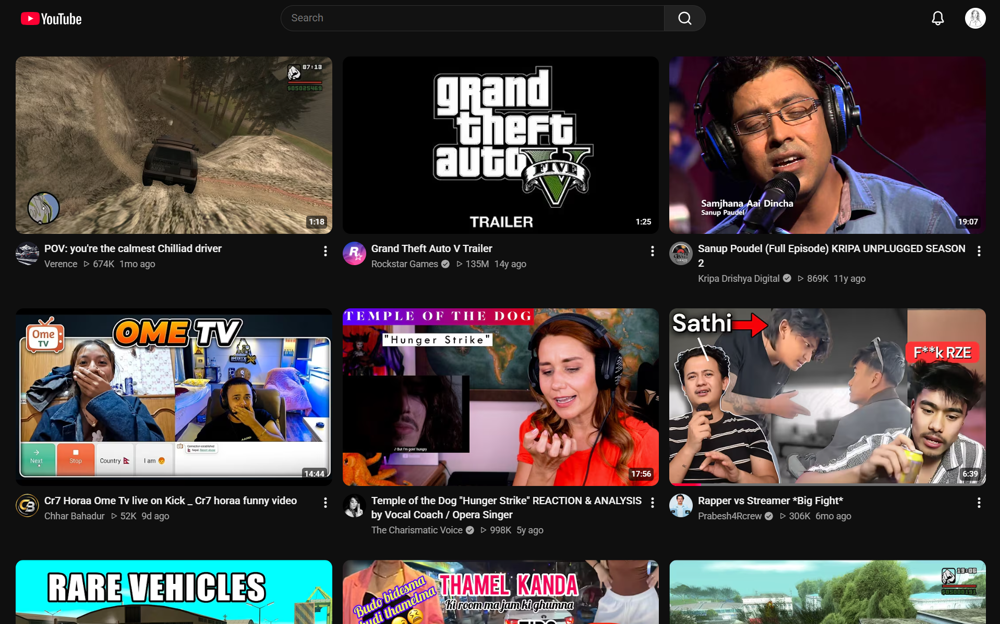

# Minimal YouTube

A browser extension that strips YouTube down to the videos.

No Shorts, no mixes, no sidebar, no topic chips, no Create button, no search history popping up before you type. Just a clean grid of videos and the things you actually use.



Minimal YouTube only changes how YouTube looks. It does not block advertisements, touch video playback, or send data anywhere.

## Features

Everything is on by default, and every item can be switched off from the popup or the options page.

**Feeds**
- Hides Shorts everywhere: shelves, tiles, channel tabs and the sidebar link
- Opens `/shorts/…` links in the normal video player
- Hides auto-generated mixes, the “All · Music · Gaming” chip bar, and non-video sections (news, posts, playables, banners)
- Hides search-page shelves like “People also watched” and related searches
- Hides sponsored placeholders in the layout

**Header & sidebar**
- Hides the sidebar (bring it back any time with a shortcut)
- Hides voice search and the Create button (the notification bell is optional)
- Hides search history until you start typing

**Watch page**
- Hides Join, Download, merch, tickets, info panels and end-screen cards
- Optionally hides recommendations and comments

YouTube's loading skeleton follows the same settings, so the page doesn't jump while it loads.

## Install

Minimal YouTube is distributed through GitHub, not the Chrome Web Store.

1. Download `minimal-youtube-vX.Y.Z.zip` from the [latest release](https://github.com/Manish-Tamang/minimal-youtube/releases/latest).
2. Unzip it into a folder you'll keep. The browser loads the extension from this folder, so don't delete it.
3. Open `chrome://extensions` (or `edge://extensions`, `brave://extensions`).
4. Turn on **Developer mode**.
5. Click **Load unpacked** and select the unzipped folder.

**To update:** download the new release, unzip it over the same folder, then click the reload icon on the extension card. Your settings are kept.

## Shortcuts

With the sidebar hidden, use the popup's quick links or these shortcuts to get around:

| Keys | Action |
| --- | --- |
| `Alt+Shift+S` | Show / hide the sidebar (works in any tab) |
| `Alt+Shift+M` | Turn Minimal YouTube on / off |
| `g` `b` | Show / hide the sidebar |
| `g` `h` / `g` `s` / `g` `r` | Home / Subscriptions / History |
| `g` `w` / `g` `l` / `g` `p` / `g` `y` | Watch later / Liked / Playlists / You |

The `g` shortcuts work on YouTube pages when you're not typing in a text field. You can change the `Alt+Shift` ones at `chrome://extensions/shortcuts`.

## Build from source

Requires Node.js 20.19+ and [pnpm](https://pnpm.io).

```sh
git clone https://github.com/Manish-Tamang/minimal-youtube.git
cd minimal-youtube
pnpm install
pnpm build
```

Then load the `dist/` folder with **Load unpacked** as described above. After each rebuild, click the reload icon on the extension card and refresh YouTube.

### Project layout

```
src/
├── background/   Global keyboard shortcuts (Alt+Shift+…)
├── content/      Runs on YouTube: applies settings, Shorts redirect, g-shortcuts
├── popup/        Toolbar popup: quick links, settings, shortcut reference
├── options/      Full settings page
├── shared/       Settings types, defaults, labels, storage helpers
└── styles/       All the hiding rules, one file per area of YouTube
```

All hiding is done in CSS. Each setting adds a `myt-<setting>` class to `<html>`, and the rules in `src/styles/` are keyed off those classes, so turning a setting on or off is instant and never scans the page.

The content script is built separately (`vite.content.config.ts`) as a single self-contained file, because content scripts can't load the shared ES module chunks the main build produces.

### When YouTube changes something

YouTube renames its elements now and then, and when it does, something hidden may come back. To fix it, right-click the element, choose **Inspect**, find its `ytd-*` or `yt-*` tag, and add it to the matching file in `src/styles/`. Pull requests with updated selectors are very welcome.

## Releasing

Releases are built by GitHub Actions. Bump `version` in `package.json` (the manifest reads it from there), commit, then push a matching tag:

```sh
git tag v0.2.0
git push origin v0.2.0
```

The [release workflow](.github/workflows/release.yml) builds the extension and attaches the zip to a new GitHub Release.

## Privacy

The extension has no backend, analytics, tracking, remote JavaScript, or external API calls. It does not collect browsing history, search queries, account information, or video data. Settings are stored with `chrome.storage.sync` in your own browser profile.

It requests only the `storage` permission, and runs only on `https://www.youtube.com/*`.

## Supported browsers

Chromium-based browsers with Manifest V3 support, including Chrome, Edge, Brave, and Chromium.

## License

MIT. See [LICENSE](LICENSE).
